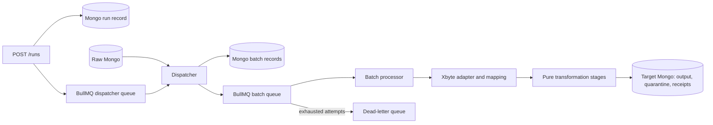

# Architecture



## Modules

```text
AppModule
├── ConfigModule (global)   env validated by config/environment.ts (class-validator)
├── BullModule.forRootAsync Redis connection and default job options
├── ThrottlerModule
├── MongoModule (global)    MongoService: client, raw and target databases, indexes
├── RunsModule              HTTP API: RunsController, RunsService, DTOs, ApiKeyGuard
├── ProcessingModule        BullMQ processors and the services they run
└── HealthModule            Terminus health check
Shared: PersistenceModule (repositories), QueuesModule (registered queues), ProvidersModule (ADAPTER)
```

## Responsibilities

| File                                        | Responsibility                                                          |
| ------------------------------------------- | ----------------------------------------------------------------------- |
| `scripts/seed-raw.ts`                       | Stream downloaded files into raw collections                            |
| `src/app.setup.ts`                          | Global ValidationPipe, shutdown hooks, OpenAPI; shared by main.ts/tests |
| `src/config/environment.ts`                 | Environment variables, defaults and validation                          |
| `src/runs/runs.controller.ts`               | HTTP routes, status codes, guards, OpenAPI annotations                  |
| `src/runs/dto/*`                            | Request DTOs (validated) and response shapes for OpenAPI                |
| `src/runs/runs.service.ts`                  | Create runs and read their status and errors                            |
| `src/queues/*`                              | Queue names, job payload types, queue registration                      |
| `src/processing/dispatch.processor.ts`      | Dispatcher worker: graceful interruption and terminal failure           |
| `src/processing/dispatcher.service.ts`      | Read source IDs in pages; save and enqueue batches                      |
| `src/processing/batch.processor.ts`         | Batch worker: concurrency, terminal failure                             |
| `src/processing/batch.service.ts`           | Transform batch documents; dead-letter exhausted batches                |
| `src/processing/document-writer.service.ts` | Save one document's entities, issues and receipt (with its counters)    |
| `src/processing/run-finalizer.service.ts`   | Decide when a run is finished and with which status; snapshot counters  |
| `src/processing/recovery.service.ts`        | On startup, re-enqueue the jobs of unfinished runs                      |
| `src/persistence/*.repository.ts`           | One repository per MongoDB collection                                   |
| `src/providers/xbyte/adapter.ts`            | Expand provider envelopes and apply its field mapping                   |
| `src/providers/xbyte/mapping.ts`            | Plain field-name mapping and provider conversions                       |
| `src/core/pipeline.ts`                      | Validate, normalize, map, project and deduplicate                       |
| `src/core/schemas.ts`                       | Allowed fields and validation rules for target entities (zod)           |
| `src/core/helpers.ts`                       | Small text/number conversions and deterministic hashing                 |

HTTP input is validated with class-validator DTOs. Provider data is validated with zod schemas in `core/` and `providers/`: it is untrusted, deeply nested and dynamic, and those schemas stay independent of Nest.

A new provider implements `Adapter`, its raw collection map and declarative field mapping, then replaces the `ADAPTER` binding. The core pipeline does not need provider-specific changes. This submission selects one provider per deployment.

## Target model

Keys begin with provider `p` (currently `xbyte-talabat`). `_id` indexes enforce uniqueness.

| Collection     | Natural key / data                                                                    | Lookup indexes                  |
| -------------- | ------------------------------------------------------------------------------------- | ------------------------------- |
| locations      | `p/locations/{locationId}`; name, slug                                                | `_id`                           |
| restaurants    | `p/restaurants/{outletId}`; name, canonical URL, profile, separate sourceRestaurantId | `_id`                           |
| service_areas  | Provider + restaurantKey + locationKey                                                | locationKey, restaurantKey      |
| categories     | `p/categories/{outletId}/{categoryId}`; name, restaurantKey                           | restaurantKey                   |
| items          | `p/items/{outletId}/{itemId}`; name, description, integer priceMinor, AED, image      | restaurantKey                   |
| category_items | Provider + categoryKey + itemKey                                                      | categoryKey/itemKey and itemKey |

Embed small scalar profiles. Reference categories, items and memberships because these arrays grow independently. Incomplete sample exports may reference locations absent from the downloaded locations file; preserve their natural keys rather than inventing records.

## Deterministic writes

The adapter assigns a version ordered by profile authority, source timestamp and source envelope ID. The core adds a content digest as a final tie-break. Menu profiles outrank sparse listings.

For each entity, `EntitiesRepository.save()` inserts missing keys and replaces existing records only when the stored `_version` is lower. Older observations cannot overwrite newer ones.

## Progress and basic recovery

1. Save the run and enqueue its dispatcher job directly.
2. For each page, save a batch, enqueue it with a stable job ID, then advance the source checkpoint. A dispatcher retry can repeat a page safely: the same page produces the same batch and job ID, finished jobs are kept for 24 hours for deduplication, and a batch that is no longer pending is skipped.
3. Look up the batch's receipts (key `{run}/{source}/{sourceId}`) in one query and skip documents that have one. For the others, save entities and upsert quarantine issues, then save the receipt with that document's counters. Run totals are the sum over receipts, so they never double count.
4. Mark the batch completed after all its documents finish. Finish the run only after scheduling is done and no pending batches remain; the finalizer checks for pending batches before summing the receipts, so the totals it stores are final. The run that wins the finish update deletes its receipts.
5. Dependency errors fail BullMQ jobs. Configurable attempts and exponential backoff apply. On the final attempt, the processor itself quarantines documents without receipts, marks the batch dead and publishes a DLQ reference before failing the job. Because this runs inside the job, a crash part-way leaves the job stalled and BullMQ runs it again; every step is idempotent.
6. On shutdown, processors close their workers in `beforeApplicationShutdown`, before MongoDB and Redis close. An active dispatch stops after its current page and moves itself back to the delayed set without using a retry attempt; it resumes from its checkpoint on the next start.

These operations are separate. A crash before the receipt is saved can leave partial output until the retry repeats the idempotent writes. A standalone MongoDB server is sufficient; transactions would require a replica set.

BullMQ handles ordinary worker stalls and retries while Redis retains its jobs. On startup, `RecoveryService` re-enqueues the dispatcher job of every running run that has not finished dispatching, and the job of every pending batch otherwise. Stable job IDs make this a no-op for jobs Redis still holds, so it repairs a crash between run creation and enqueueing, and lost Redis jobs, at the next restart. Source data must stay immutable. Run one application instance.
