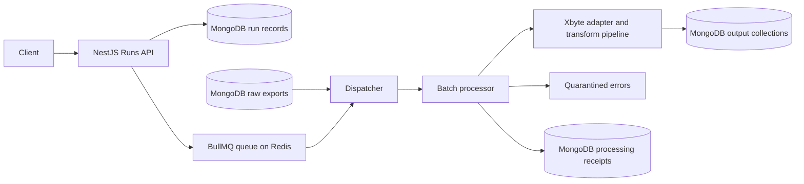

# Provider Data Factory

A small NestJS service that turns Xbyte/Talabat exports into clean restaurant data. MongoDB stores raw data and output in separate databases; BullMQ and Redis handle background jobs.

## Architecture



The API creates a run and queues the work. The dispatcher pages through raw export IDs and schedules batches. Workers transform each batch, save output, and quarantine invalid records; processing receipts make retries safe.

## Run locally

Requires Node 22+, MongoDB on port 27017, and Redis installed. A standalone MongoDB server is sufficient.

```sh
npm ci --ignore-scripts
npm start
```

`npm start` builds the app, starts Redis if needed, and serves the API at http://localhost:3000. Ctrl+C stops the app and any Redis process it started. MongoDB stays running.

The launcher loads `.env` if present. Defaults: MongoDB on 27017, Redis on 43179, API on 3000. See [.env.example](.env.example) for configuration. On Windows, Redis is discovered under `%LOCALAPPDATA%/Programs/redis`; otherwise put `redis-server` on PATH or set `REDIS_SERVER_PATH`.

## Load data and start a run

Place these exports in `data/`:

```text
compero-xbyte.xbyte-raw-locations.json
compero-xbyte.xbyte-raw-restaurants.json
compero-xbyte.xbyte-raw-menus.json
```

With MongoDB running, seed the raw database after building:

```sh
npm run seed -- --dir data
```

For other filenames, pass `--locations PATH --restaurants PATH --menus PATH`. The seeder streams batches of 100 and preserves MongoDB IDs and dates. Only the seeder writes raw data; keep it unchanged during a run. Downloads are excluded from Git because their URLs contain provider credentials.

| Endpoint                                       | Purpose                                                  |
| ---------------------------------------------- | -------------------------------------------------------- |
| `POST /runs`                                   | Start a run (202 Accepted); `{}` selects all collections |
| `GET /runs/:id`                                | Status, timing, counters and an error sample             |
| `GET /runs/:id/errors?limit=25&after=ERROR_ID` | Paginated quarantined issues                             |
| `GET /health`                                  | MongoDB and Redis availability (Terminus format)         |
| `GET /docs`                                    | OpenAPI (Swagger) UI; the JSON is at `/docs-json`        |

```sh
curl -X POST http://localhost:3000/runs -H "Content-Type: application/json" -d '{}'
curl http://localhost:3000/runs/RUN_ID
```

To process a smaller slice, send `{"collections":["menus"],"limit":10}`. The limit counts raw envelopes per selected collection. Request bodies and query strings are validated with DTOs: invalid or unknown fields return 400, unknown runs return 404.

Set `API_KEY` (16+ characters) to require an `x-api-key` header on every `/runs` request. Without it the API is open, which is allowed for local development only: with `NODE_ENV=production` the app refuses to start without a key. `POST /runs` is rate limited to 10 requests per minute per client.

PowerShell:

```powershell
Invoke-RestMethod http://localhost:3000/runs -Method Post -ContentType application/json -Body '{"collections":["menus"],"limit":10}'
```

## Docker

```sh
export API_KEY=$(openssl rand -hex 16)   # required: the image runs with NODE_ENV=production
docker compose up --build -d
docker compose run --rm -v "${PWD}/data:/data:ro" app npm run seed -- --dir /data
```

Then use the same API on port 3000 with the `x-api-key` header. Compose runs MongoDB and Redis with persistent volumes. The Compose stack was not executed on the authoring machine; integration tests use native MongoDB and Redis processes.

## How it works

1. `RunsService` saves a run and enqueues its dispatcher job.
2. `DispatchProcessor` (a BullMQ `WorkerHost`) runs `DispatcherService`, which pages through source IDs, saves batches, and queues them with stable job IDs.
3. `BatchProcessor` runs `BatchService`, which passes each document through the Xbyte adapter and the pure transformation pipeline; `DocumentWriter` saves entities and quarantined issues, then a receipt holding that document's counters.
4. A receipt skips completed documents on retry. `RunFinalizer` finishes the run when dispatch and all batches are done, stores the final counters on the run and deletes its receipts.
5. On startup, `RecoveryService` re-enqueues the dispatcher or pending batch jobs of unfinished runs (a no-op for jobs Redis still holds).

Start reading at `src/runs/runs.controller.ts`, then `src/processing/` (processors, then services). Provider fields and conversions live in `src/providers/xbyte`; shared transformation stages live in `src/core/pipeline.ts`. Each MongoDB collection has one repository in `src/persistence/`. See [ARCHITECTURE.md](ARCHITECTURE.md) for the module layout, model and recovery details, and [ANALYSIS.md](ANALYSIS.md) for source findings.

Key choices:

- Stable natural keys prevent duplicate entities. Items can belong to multiple categories.
- Restaurant URL IDs match menu `outletCode`; menu `id` is kept separately as `sourceRestaurantId`.
- Rich menu profiles outrank listing summaries. Timestamp, source ID and content hash break ties consistently, regardless of worker order.
- Prices use integer fils; the adapter removes observed float32 noise before conversion.
- Invalid provider data is quarantined. Dependency failures retry with exponential backoff; exhausted batch jobs become dead batches with a dead-letter queue reference.

Counters: `read` counts processed envelopes; `transformed` counts envelopes producing entities; `written` counts inserted/replaced entities; `skipped` counts duplicate, unchanged or older entities; `failed` counts quarantined issues. Counters are summed from per-document receipts, so retries never count a document twice. While a run is active they are computed live; when it finishes they are stored on the run. If a crash interrupts a document after its entities were saved, the retry reports those entities as `skipped` rather than `written`.

## Tests and checks

```sh
npm test                  # unit tests: pipeline, adapter, DTOs, services (via @nestjs/testing)
npm run test:integration  # real MongoDB + Redis through HTTP
npm run lint              # ESLint (typescript-eslint, type-checked rules)
npm run format:check      # Prettier
npm run typecheck
```

Integration tests start temporary MongoDB and Redis processes. Redis must be on PATH or configured through `REDIS_SERVER_PATH`; `mongodb-memory-server` downloads MongoDB on first use. Tests cover validation, deterministic transformation, repeated runs, checkpoints, restart with persisted jobs, shutdown during dispatch, and exhausted retries. Set `SAMPLE_DIR` to also test the downloaded exports.

Earlier full-export runs processed 578 envelopes: 421 produced entities and 157 were quarantined provider error responses. A second run wrote zero entities and left domain data unchanged.

## Deliberately left out

- **Atomic document writes.** Entities, issues and the receipt are saved separately. A crash can leave partial output until the retry repeats those idempotent writes; counters stay exact because they come from receipts. Transactions and replica-set setup are left out to keep standalone MongoDB support.
- **Periodic queue reconciliation.** Unfinished runs are re-enqueued at startup only. A run whose jobs are lost while the app keeps running (Redis data loss, or a crash between saving a run and enqueueing it without a restart) waits for the next restart.
- **Data retention.** Receipts are deleted when a run finishes. Runs, batch records, quarantined issues and dead letters are kept until removed manually.
- **Multiple app instances, backpressure and automatic DLQ replay.** Run one instance. Completed jobs are kept for 24 hours (failed jobs for 7 days) for job-ID deduplication and inspection, then removed; dead letters are kept until handled.
- **Deletion sync and source snapshots.** Keep raw data immutable during a run. The dispatcher records an upper ID bound, which does not protect against edits or inserts below that bound. Removed source entities are not deleted from the output.
- **Extra profile fields and product features.** Delivery fees, ETA, reviews and merchandising order are outside the chosen data slice. User accounts, a frontend, cloud deployment and a second provider adapter are outside this assignment's scope.
